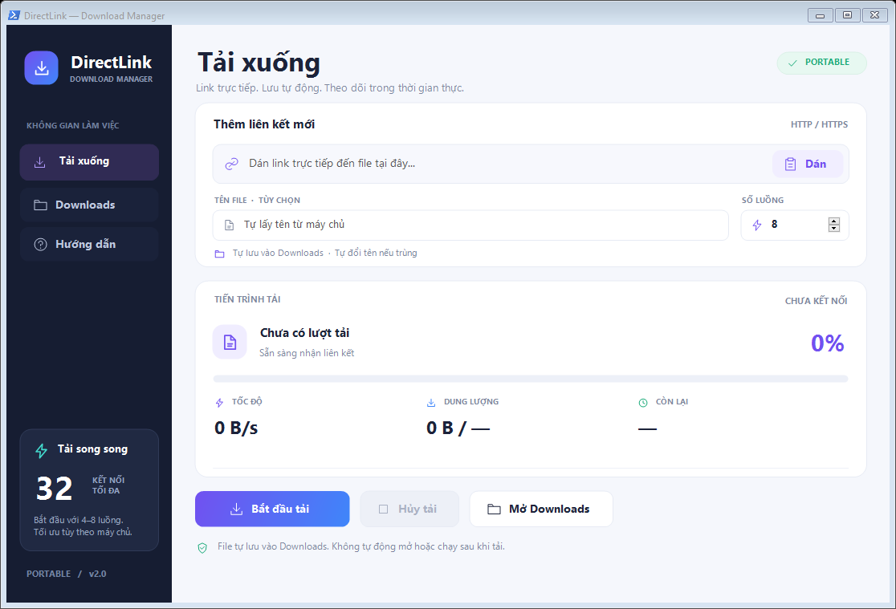
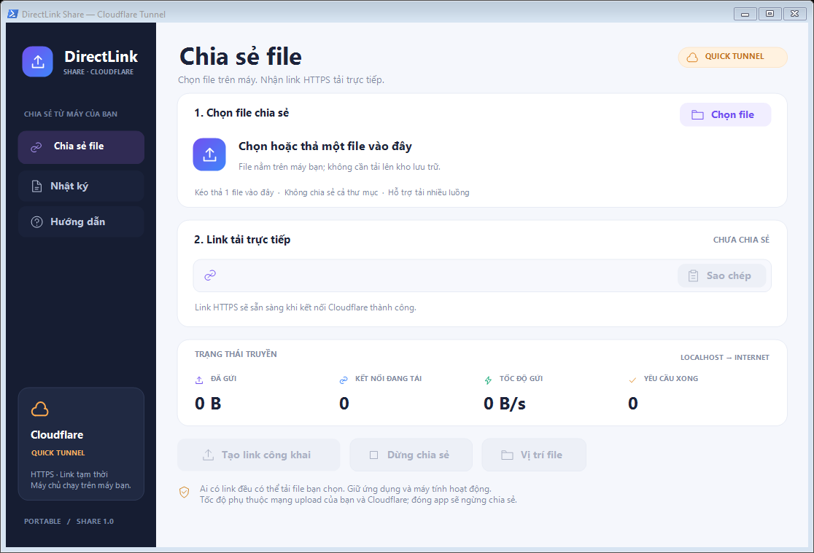

# DirectLink Tools

Hai ứng dụng Windows portable có giao diện tiếng Việt: **tải file nhiều luồng** và **chia sẻ file qua Cloudflare Tunnel**. Mỗi ứng dụng được phát hành dưới dạng một file EXE.

| Ứng dụng | Chức năng |
| --- | --- |
| **DirectLink Downloader** | Tải link HTTP/HTTPS bằng 1–32 luồng, tự lưu vào Downloads, hiển thị tiến độ và biểu đồ tốc độ. |
| **DirectLink Share** | Chọn một file trên máy và tạo link HTTPS tải trực tiếp bằng Cloudflare Quick Tunnel. Hỗ trợ HTTP Range cho trình tải nhiều luồng. |

## Tải ứng dụng

Mở [**Releases**](https://github.com/Longdeptrai1107/directlink-tools/releases/latest) để tải:

- [DirectLinkDownloader.exe](https://github.com/Longdeptrai1107/directlink-tools/releases/latest/download/DirectLinkDownloader.exe) — trình tải file.
- [DirectLinkShare.exe](https://github.com/Longdeptrai1107/directlink-tools/releases/latest/download/DirectLinkShare.exe) — trình chia sẻ file.
- [SHA256SUMS.txt](https://github.com/Longdeptrai1107/directlink-tools/releases/latest/download/SHA256SUMS.txt) — mã SHA-256 để đối chiếu các file phát hành.

Không cần tải mã nguồn để sử dụng. Windows cần có **.NET Framework 4.7.2 trở lên**; DirectLink Share yêu cầu Windows 64 bit. Các EXE ứng dụng chưa ký số.

## DirectLink Downloader



1. Dán link HTTP/HTTPS trực tiếp đến file.
2. Để trống tên file để tự nhận từ máy chủ hoặc nhập tên tùy chọn.
3. Chọn số luồng, mặc định 8, rồi bấm **Bắt đầu tải**.

File tự lưu vào thư mục Downloads của Windows. Nếu trùng tên, ứng dụng thêm số thay vì ghi đè. Máy chủ không hỗ trợ Range sẽ được tải bằng một luồng. Có thử lại khi lỗi kết nối, kiểm tra kích thước và dọn file tạm.

[Hướng dẫn và giới hạn của Downloader](docs/Downloader.md)

## DirectLink Share



1. Chọn hoặc kéo thả **một file**.
2. Bấm **Tạo link công khai**.
3. Chờ kết nối thành công rồi bấm **Sao chép** để gửi link.

File vẫn nằm trên máy của bạn, được truyền qua localhost và Cloudflare Tunnel. **Ai có link đều có thể tải file được chọn.** Giữ máy, mạng và ứng dụng hoạt động; dừng chia sẻ hoặc đóng app sẽ ngừng phục vụ file. Mỗi phiên dùng link mới.

`cloudflared` chính thức được nhúng trong EXE, kiểm tra SHA-256 rồi giải nén tạm khi chạy. Không cần cài cloudflared riêng. Máy chủ cục bộ chỉ phục vụ đúng file được chọn, không mở cả thư mục.

**Điều kiện mạng:** Share cần kết nối ra Cloudflare qua TCP **7844**. Trong lần kiểm thử Internet trên máy phát triển, Cloudflare đã cấp hostname nhưng kết nối tunnel qua cổng này không thành công. Kiểm thử tải công khai từ đầu đến cuối chưa thành công trên mạng đó; ứng dụng chỉ bật sao chép link sau khi kiểm tra URL công khai thành công. Quick Tunnel dành cho chia sẻ tạm thời, không có cam kết uptime.

[Hướng dẫn và giới hạn của Share](Share/README.md)

## Biên dịch

Chạy trong **Windows PowerShell 5.1**, trên Windows 64 bit có .NET Framework. Build script dùng C# compiler có sẵn của .NET Framework; không cần .NET SDK.

```powershell
powershell -NoProfile -ExecutionPolicy Bypass -File .\Build.ps1
powershell -NoProfile -ExecutionPolicy Bypass -File .\Build-Share.ps1
```

Kết quả:

```text
release/DirectLinkDownloader.exe
release-share/DirectLinkShare.exe
```

Build Share tải bản cloudflared chính thức đã ghim phiên bản và xác minh SHA-256. Cần Internet ở lần build đầu. Icon, manifest, cloudflared và giấy phép thành phần được nhúng vào EXE tương ứng.

## Kiểm thử

```powershell
# Bộ tải và máy chủ chia sẻ, dùng dữ liệu thử nghiệm cục bộ
powershell -NoProfile -ExecutionPolicy Bypass -File .\Test.ps1
powershell -NoProfile -ExecutionPolicy Bypass -File .\Test-Share.ps1

# Thao tác trên giao diện Windows
powershell -NoProfile -ExecutionPolicy Bypass -File .\Test-UI.ps1
powershell -NoProfile -ExecutionPolicy Bypass -File .\Test-Share-UI.ps1

# Tùy chọn: mở tunnel công khai cho file dữ liệu thử nghiệm được tạo riêng
powershell -NoProfile -ExecutionPolicy Bypass -File .\Test-Share.ps1 -Internet
```

Các bộ kiểm thử cục bộ đã kiểm tra tải 8 luồng với SHA-256 khớp, phản hồi Range sai, thử lại, hủy, tên file tiếng Việt, tránh ghi đè, khóa file đang chia sẻ và đóng máy chủ. Bài kiểm thử Internet chỉ dùng dữ liệu tự sinh, không chia sẻ file cá nhân.

Tốc độ thực tế phụ thuộc máy chủ, ổ đĩa và đường truyền. Với Share, băng thông **upload** của máy chia sẻ là một giới hạn chính; nhiều luồng không bảo đảm vượt được giới hạn đường truyền.

## Thành phần bên thứ ba

DirectLink Share nhúng `cloudflared` của Cloudflare theo Apache License 2.0. Xem [thông tin thành phần](THIRD_PARTY_NOTICES.md) và mục **Hướng dẫn → Giấy phép cloudflared** trong ứng dụng.
